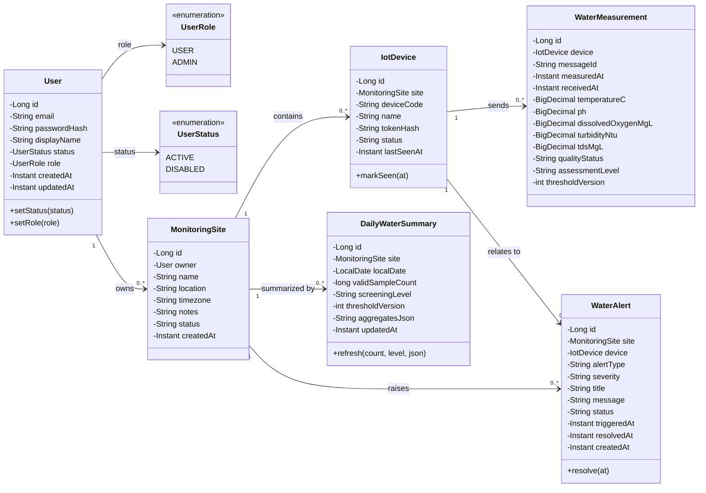
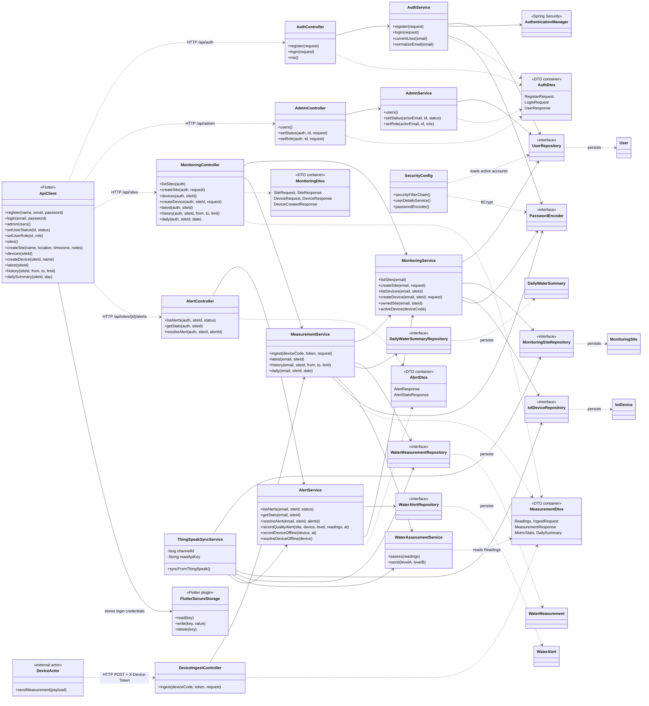

# Sơ đồ lớp hệ thống quan trắc chất lượng nước

Sơ đồ được đối chiếu với cấu trúc hiện tại trong `backend/src/main/java/com/example/backend`. Phần thứ nhất mô tả lớp dữ liệu và quan hệ lưu trữ; phần thứ hai mô tả các lớp Flutter/API/service/repository thực hiện các UC. Các lớp DTO được rút gọn để sơ đồ dễ đọc.

## 1. Lớp nghiệp vụ và quan hệ dữ liệu

Các quan hệ trên phản ánh khóa ngoại trong database: site thuộc một User; thiết bị thuộc một site; phép đo thuộc một thiết bị; bản tổng hợp ngày thuộc một site. Mã nguồn JPA khai báo các liên kết từ phía lớp con (`ManyToOne`); các bội số phía `0..*` được suy ra từ khóa ngoại, không phải danh sách collection được khai báo trên lớp cha. `MonitoringSite.status` và `IotDevice.status` hiện là `String`; chỉ role và trạng thái User là enum.

`WaterMeasurement` có ràng buộc duy nhất theo cặp `(device_id, message_id)` để chống nhận trùng gói trên cùng thiết bị. `DailyWaterSummary` có ràng buộc duy nhất theo `(site_id, local_date, threshold_version)`.

## 2. Lớp giao tiếp và xử lý nghiệp vụ

Các repository trong sơ đồ là interface Spring Data JPA kế thừa `JpaRepository` cho entity tương ứng; các phương thức truy vấn thực tế nằm trong từng interface repository của mã nguồn.

## 3. Cách đọc sơ đồ theo các UC (Use Case Realization)

- **Administration (Quản trị tài khoản):** `AdminController` → `AdminService` → `UserRepository` → `User`.
- **Site Management (Quản lý điểm đo):** `MonitoringController` → `MonitoringService` → `MonitoringSiteRepository` → `MonitoringSite`.
- **Device Management (Quản lý thiết bị IoT):** `MonitoringController` → `MonitoringService` → `IotDeviceRepository` → `IotDevice`.
- **Water Quality Summary (Theo dõi chất lượng & Lịch sử số đo):** `MonitoringController` → `MeasurementService` → `WaterMeasurementRepository` / `DailyWaterSummaryRepository`; `WaterAssessmentService` đánh giá mức độ ô nhiễm theo ngưỡng quy chuẩn.
- **Measurement Ingestion (Tiếp nhận số đo từ cảm biến):** `DeviceIngestController` → `MeasurementService` → xác thực token qua `MonitoringService`, lưu `WaterMeasurement`, cập nhật `lastSeenAt` trên `IotDevice`, rồi chuyển `WaterAssessmentService` đánh giá.
- **ThingSpeak Cloud Integration (Tự động thu thập từ ThingSpeak):** `ThingSpeakSyncService` (chạy nền định kỳ `@Scheduled`) tự động lấy số đo mới từ API ThingSpeak, nạp vào `WaterMeasurementRepository`, cập nhật trạng thái online cho `IotDevice`, đồng thời kích hoạt `AlertService`.
- **Early Warning & Alert System (Trung tâm cảnh báo tự động):** `AlertController` → `AlertService` → `WaterAlertRepository` → `WaterAlert`. Khi phát hiện chỉ số nước vượt ngưỡng (WATCH, HIGH, CRITICAL) hoặc thiết bị mất kết nối, cảnh báo sẽ được kích hoạt tự động.
- `ApiClient` là lớp phía Flutter Client gọi các API RESTful qua giao thức HTTP; dữ liệu phản hồi được map thành các Model tương ứng trong ứng dụng.
