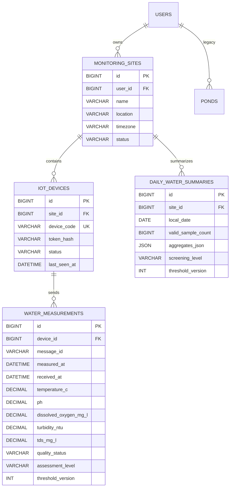

# Thiết kế dữ liệu — Giám sát chất lượng nước

Mục tiêu database: MySQL 8+, `utf8mb4`; thời điểm đo/nhận lưu UTC. Ngày báo cáo xác định theo múi giờ của điểm quan trắc.

## ERD hiện đã triển khai

## Ràng buộc chính

- Unique `(device_id, message_id)` chống gói trùng.
- Index `(device_id, measured_at)` và `(site_id, local_date)` phục vụ lịch sử/báo cáo.
- Thời điểm đo và nhận lưu UTC; ngày báo cáo chuyển từ UTC theo timezone của điểm đo.
- Số đo có đơn vị cố định: nhiệt độ °C, pH, DO mg/L, độ đục NTU, TDS mg/L.
- `token_hash` chứa hash BCrypt; token thiết bị chỉ trả một lần khi tạo thiết bị.
- Dữ liệu đo thô giữ nguyên; `assessment_level` và `threshold_version` cho phép truy lại cách đánh giá.
- Tổng hợp ngày lưu min/avg/max và count cho từng chỉ số trong JSON.

## Ngưỡng đánh giá

Phiên bản hiện tại (`threshold_version = 1`) lấy ngưỡng sàng lọc từ cấu hình `monitoring.thresholds.*` trong `application.properties`. Đây là giá trị thử nghiệm, chưa phải quy chuẩn. Cần lưu bộ ngưỡng và nguồn tham khảo thành bảng phiên bản hóa khi làm dashboard cấu hình ngưỡng.

## Migration

`database/migrations/V2__iot_water_monitoring.sql` thêm 4 bảng quan trắc và không xóa dữ liệu cũ. `database/schema-mvp.sql` vẫn tạo các bảng nền ao cá để backend cũ tiếp tục validate trong giai đoạn chuyển tiếp. Backend hiện vẫn giữ các endpoint ao/đợt nuôi cũ; có thể gỡ chúng sau khi client chuyển sang `/api/sites`.
