# Sơ đồ tuần tự theo Use Case

Tài liệu này ánh xạ từng UC con trong `da-Trang-3.drawio (1).png` vào luồng đang có trong dự án, rồi bổ sung các luồng hệ thống cần để vận hành các UC đó. Các UC tổng quát Administration, Site Management, Device Management, Water Quality Summary và Measurement Ingestion được nhóm theo đúng quan hệ trong hình.

**Cơ chế xác thực thực tế:** Flutter gửi email/mật khẩu tới API đăng nhập; backend không phát JWT/session token. Flutter lưu thông tin đăng nhập trong secure storage và dùng HTTP Basic cho API cần tài khoản. Spring Security giới hạn `/api/admin/**` cho role `ADMIN`. Endpoint ingest được mở ở Spring Security nhưng service bắt buộc kiểm tra deviceCode đang ACTIVE và `X-Device-Token` bằng BCrypt hash.

## Chức năng hệ thống: Đăng ký và tự đăng nhập
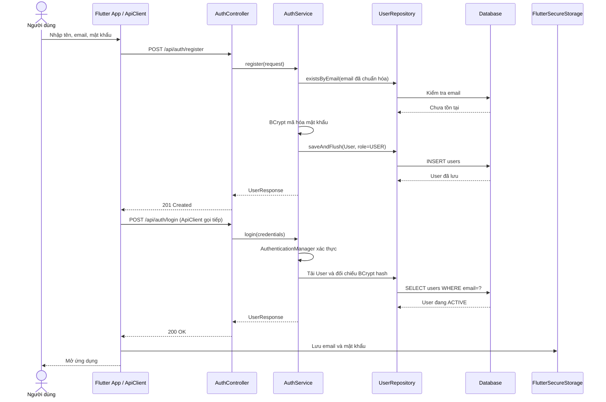

## Chức năng hệ thống: Đăng nhập
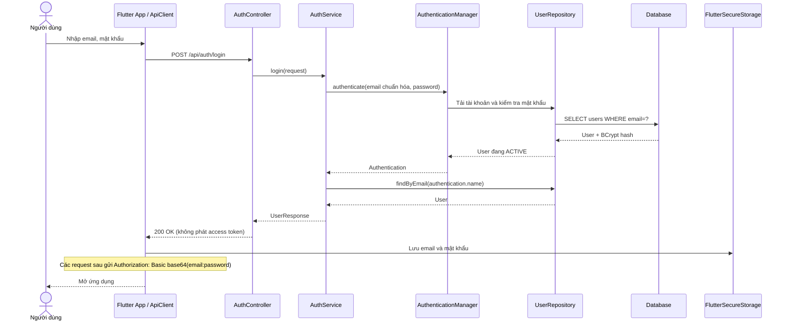

## UC tổng quát: Water Quality Summary — Flutter tải dashboard

Trong Flutter, `_load()` tải danh sách điểm đo trước; khi đã chọn một site, bốn truy vấn thiết bị, số đo mới nhất, tổng hợp ngày và lịch sử được gọi song song. Các UC chi tiết tương ứng được mô tả riêng ở các mục sau.

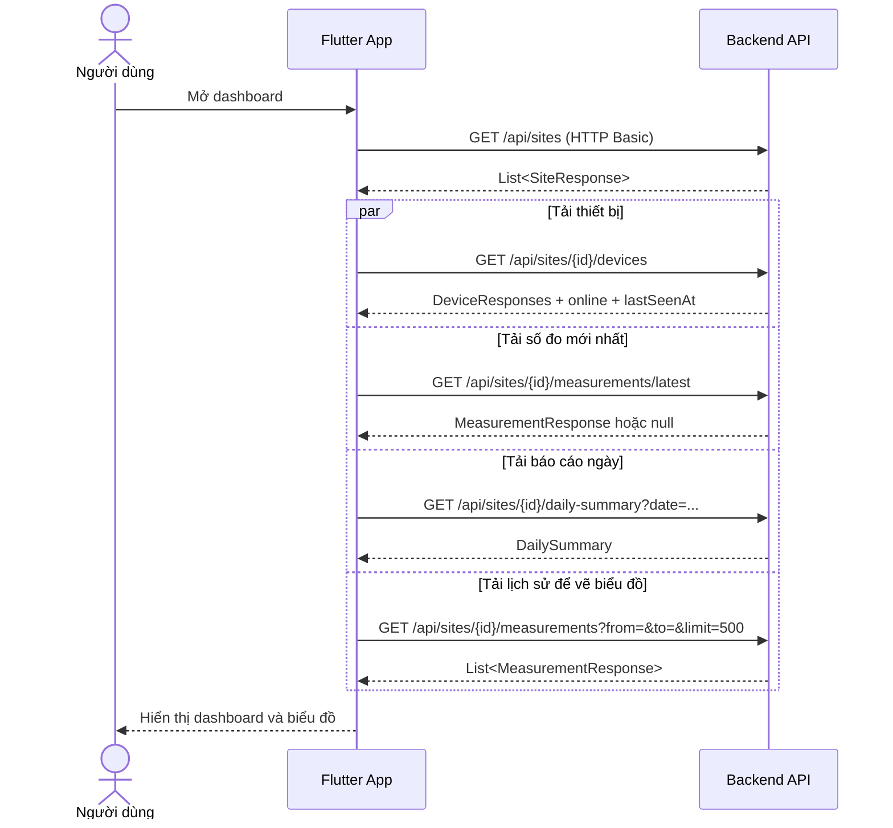

## UC tổng quát: Administration

Administration được thực hiện bằng ba UC con bên dưới. Tất cả endpoint `/api/admin/**` qua Spring Security và chỉ role `ADMIN` được gọi.

### UC: Xem danh sách tài khoản (View User Accounts)
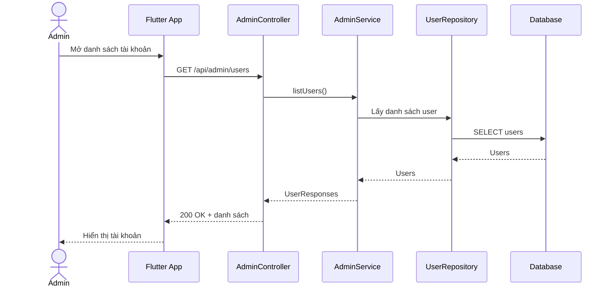

### UC: Cập nhật trạng thái tài khoản (Update Account Status)
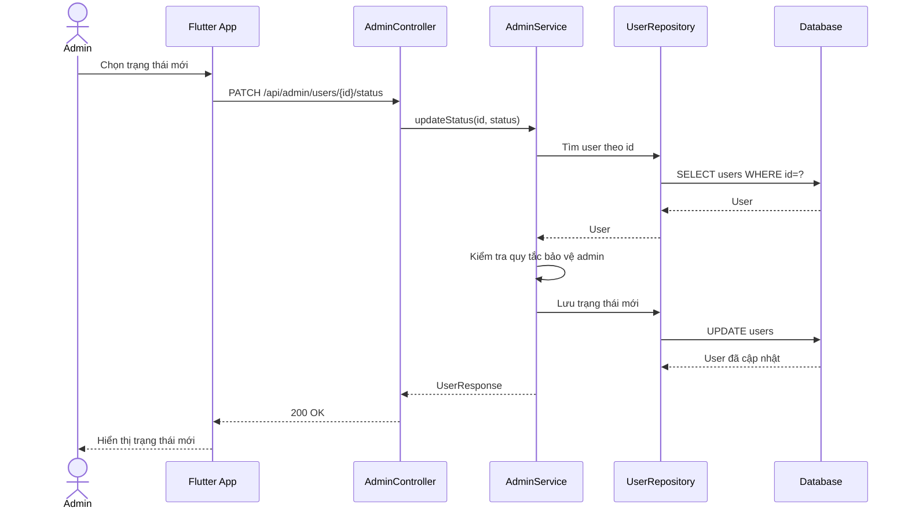

### UC: Đổi vai trò người dùng (Change User Role)
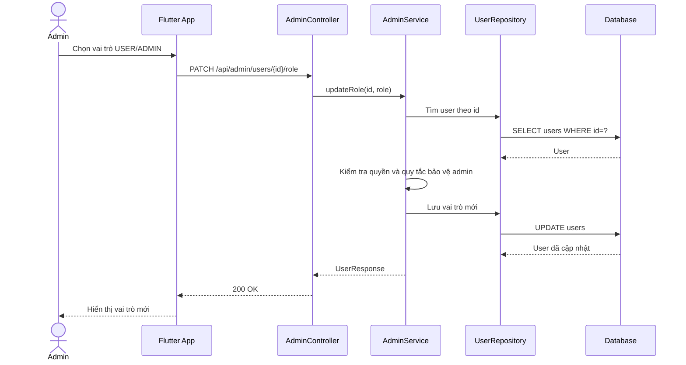

## UC tổng quát: Site Management

Site Management trong hình gồm tạo site và xem danh sách site. Backend hiện có hai API tương ứng; không có API cập nhật hoặc xóa site.

### UC: Tạo điểm quan trắc (Create Monitoring Site)
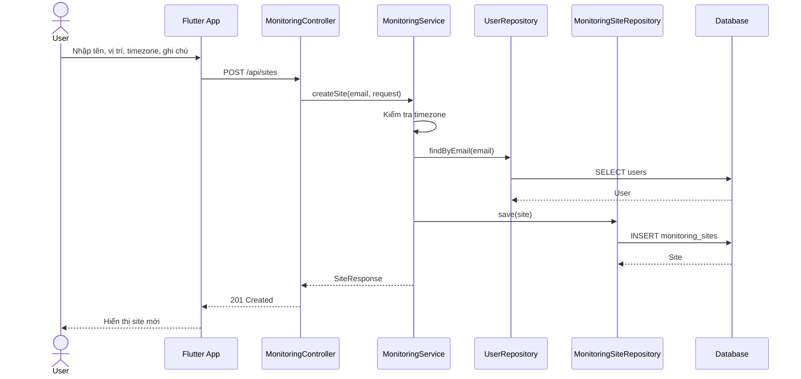

### UC: Xem danh sách điểm quan trắc (View Monitoring Sites)
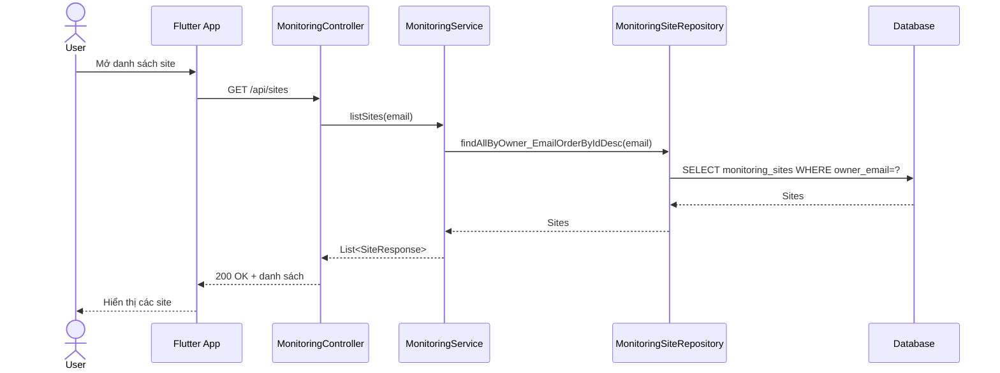

## UC tổng quát: Device Management

Device Management trong hình gồm đăng ký thiết bị và xem danh sách cùng lần gửi gần nhất.

### UC: Đăng ký thiết bị IoT (Register IoT Device)
```mermaid
sequenceDiagram
 actor User as User
 participant App as Flutter App
 participant C as MonitoringController
 participant S as MonitoringService
 participant SR as MonitoringSiteRepository
 participant DR as IotDeviceRepository
 participant DB as Database
 User->>App: Chọn site, nhập tên thiết bị
 App->>C: POST /api/sites/{siteId}/devices
 C->>S: createDevice(email, siteId, request)
 S->>SR: Xác minh site thuộc user
 SR->>DB: SELECT site theo id và owner
 DB-->>SR: Site
 S->>S: Sinh deviceCode, token; băm token
 S->>DR: save(device)
 DR->>DB: INSERT iot_devices (token_hash)
 DB-->>DR: Device
 S-->>C: DeviceCreatedResponse (token trả một lần)
 C-->>App: 201 Created + deviceCode + token
 App-->>User: Hiển thị thông tin cấu hình
```

### UC: Xem thiết bị / lần gửi gần nhất (View Devices / Last Seen)
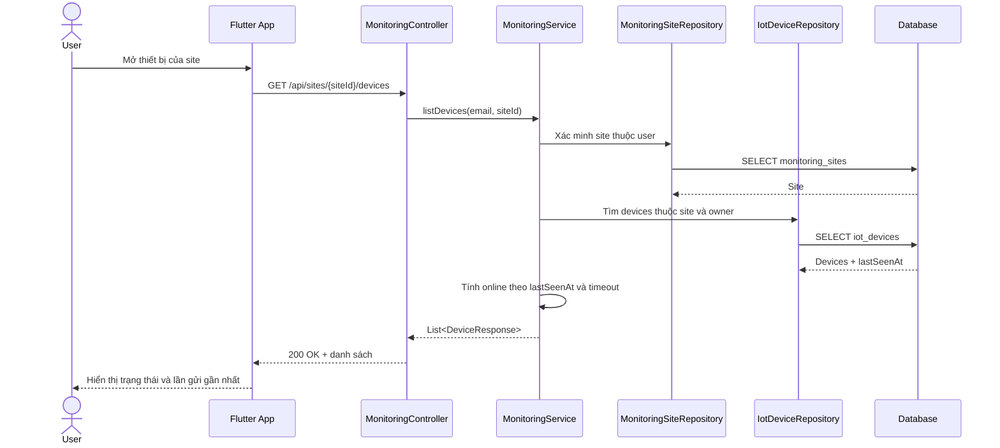

## UC tổng quát: Water Quality Summary

Nhóm này gồm bốn UC con. Flutter tải một số dữ liệu đồng thời cho dashboard; mỗi UC dưới đây mô tả endpoint/backend cụ thể.

### UC: Xem số đo mới nhất (View Latest Measurement)
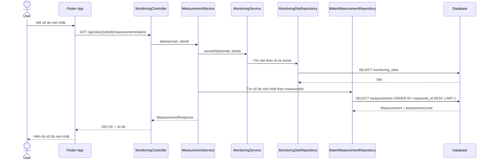

### UC: Xem lịch sử số đo (View Measurement History)
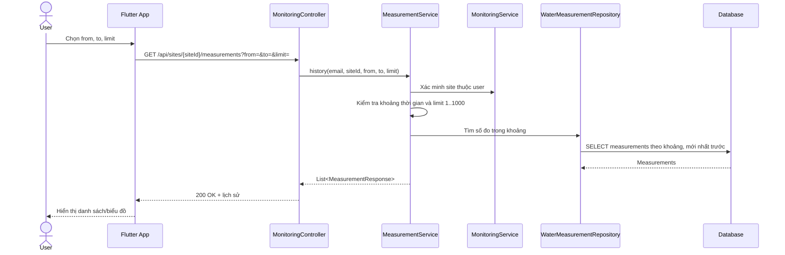

### UC: Xem tổng hợp chất lượng nước theo ngày (View Daily Water Quality Summary)
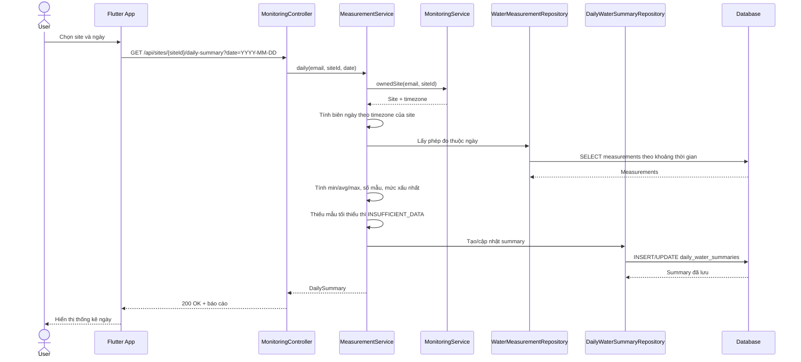

### UC: Xem đánh giá sàng lọc (View Screening Assessment)
```mermaid
sequenceDiagram
 actor User as User
 participant App as Flutter App
 participant C as MonitoringController
 participant S as MeasurementService
 participant MS as MonitoringService
 participant MR as WaterMeasurementRepository
 participant SR as DailyWaterSummaryRepository
 participant DB as Database
 User->>App: Chọn ngày/xem thẻ đánh giá tổng hợp
 App->>C: GET /api/sites/{siteId}/daily-summary?date=YYYY-MM-DD
 C->>S: daily(email, siteId, date)
 S->>MS: ownedSite(email, siteId)
 MS-->>S: Site + timezone
 S->>MR: Lấy measurements của site trong ngày
 MR->>DB: SELECT measurements theo khoảng ngày
 DB-->>MR: Measurements + assessmentLevel đã lưu
 S->>S: Gộp mức sàng lọc xấu nhất; kiểm tra số mẫu tối thiểu
 S->>SR: Lưu/cập nhật daily summary
 SR->>DB: INSERT/UPDATE daily_water_summaries
 DB-->>SR: Summary
 S-->>C: DailySummary (screeningLevel)
 C-->>App: 200 OK + summary
 App-->>User: Hiển thị mức sàng lọc trong ngày
```

UC “View Daily Water Quality Summary” và “View Screening Assessment” hiện cùng đọc endpoint `/daily-summary`: response chứa cả thống kê min/average/max và `screeningLevel`; Flutter dùng `screeningLevel` trên thẻ đánh giá. Backend yêu cầu đủ số mẫu tối thiểu (mặc định 24); nếu không đủ, trả `INSUFFICIENT_DATA`. Đánh giá từng phép đo được tạo lúc ingest. Các ngưỡng áp dụng cho pH, oxy hòa tan, độ đục và TDS; nhiệt độ được thống kê nhưng không dùng để xếp mức.

## UC tổng quát: Measurement Ingestion

Trong sơ đồ UC, ESP32/Water Sensor khởi tạo luồng ingest; User cũng có quan hệ với UC tổng quát. Luồng xử lý thực tế bắt đầu khi thiết bị POST số đo.

### UC: Gửi số đo qua HTTP API (Submit Measurement via HTTP API)
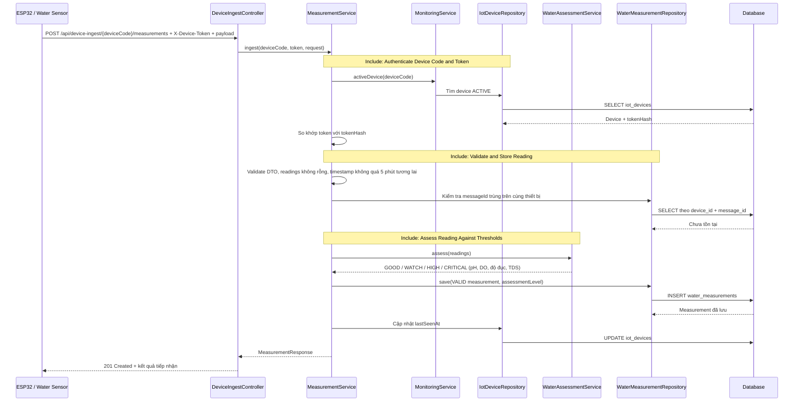

Trong bước validate, DTO giới hạn nhiệt độ `-5..60`, pH `0..14`, oxy hòa tan `0..50`, độ đục và TDS không âm; request phải có ít nhất một giá trị đọc, `messageId` không được trùng trên cùng thiết bị, và `measuredAt` không được quá 5 phút trong tương lai. Dữ liệu hợp lệ được lưu với `qualityStatus=VALID`. `lastSeenAt` được cập nhật khi ingest thành công.
