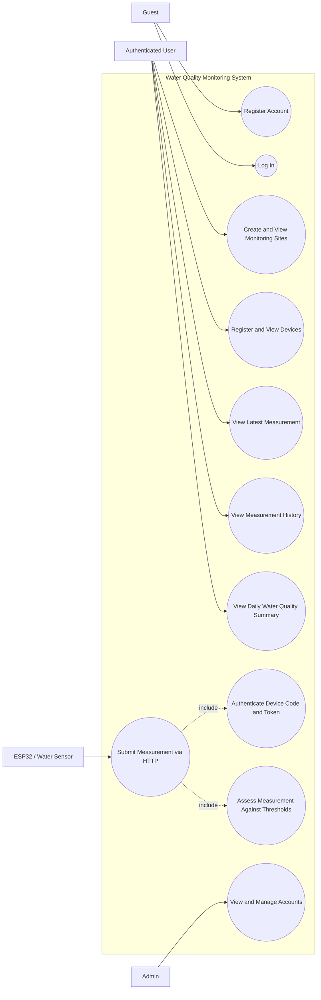
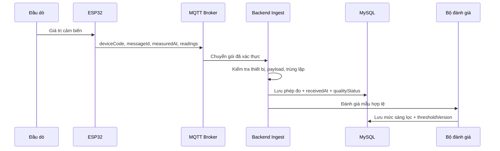
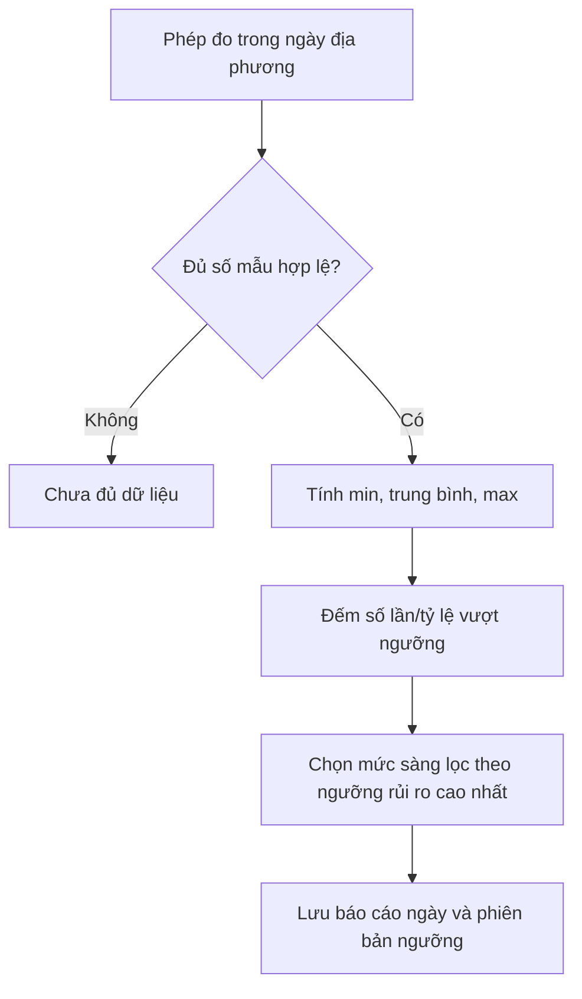
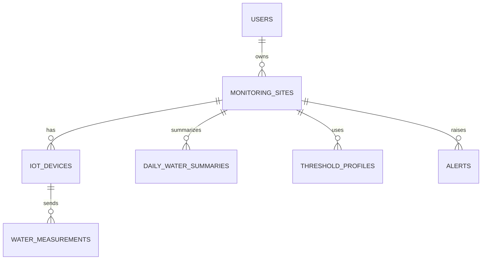

# Sơ đồ hệ thống — MVP quan trắc nước bằng IoT

## Current System Use Case Diagram

Users register or log in before managing monitoring sites and viewing data. A device submits measurements to the HTTP API with its device code and `X-Device-Token`; the backend authenticates the device, stores the measurement, and evaluates it against configured thresholds. Daily summaries are derived from measurements and may report insufficient data.

## Luồng nhận dữ liệu và đánh giá

## Tổng hợp báo cáo ngày

## Quan hệ dữ liệu chính

Các sơ đồ mô tả kiến trúc đích; backend hiện tại chưa tích hợp MQTT hay tính báo cáo ngày.
